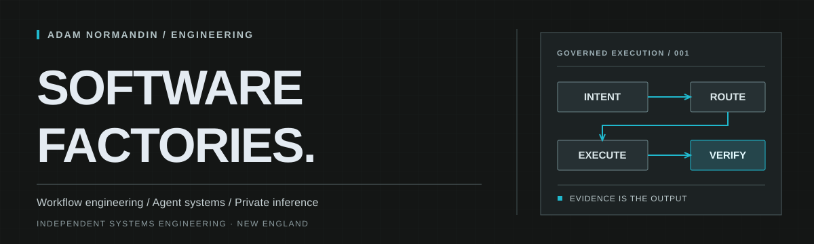
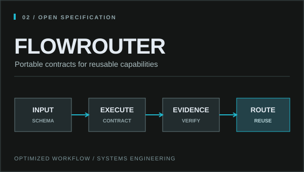
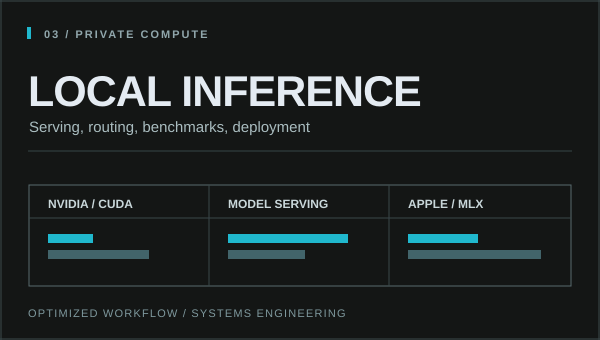
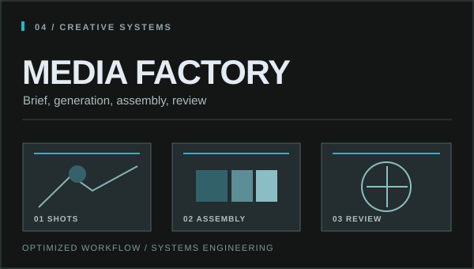

  

I’m **Adam Normandin**. I build workflow software, agent infrastructure, and private inference systems at **[Optimized Workflow](https://optimizedworkflow.dev)** in New England.

My work sits between software and operations: define the job, build the execution path, test what happened, and leave evidence someone else can inspect. Before software, I worked in telecommunications infrastructure. That background still shapes how I think about reliability, field conditions, and handoffs.

**[Optimized Workflow](https://optimizedworkflow.dev)** · **[Engineering approach](https://optimizedworkflow.dev/architecture)** · **[X / @opworkflow](https://x.com/opworkflow)**

---

### Selected work

<table>
<tr>
<td width="50%" valign="top">

 
<strong><a href="https://github.com/Foshowithit/dsh-operator-ui">01 / DSH Operator UI</a></strong> 
Public integration surface for governed agent work: requests, routing, execution, evidence, and verdicts. The reproducible public install is the locked web-profile package; native Desktop integration is a development preview.
</td>
<td width="50%" valign="top">

 
<strong><a href="https://github.com/Foshowithit/flowrouter">02 / FlowRouter</a></strong> 
An open capability-manifest specification: inputs, execution contracts, routing metadata, and verifiable evidence. Version 0.1 is frozen; the repository includes its schema, examples, and validator.
</td>
</tr>
<tr>
<td width="50%" valign="top">

 
<strong><a href="https://optimizedworkflow.dev/services/inference-benchmark">03 / Local inference</a></strong> 
Benchmarking open-weight models on available hardware, studying concurrency and memory behavior, and building private or hybrid serving paths. Measurements and configurations matter more than model-name rankings.
</td>
<td width="50%" valign="top">

 
<strong><a href="https://optimizedworkflow.dev/">04 / Media Factory</a></strong> 
A production workflow for motion and video: brief, assets, generation, assembly, and quality review. This is an active internal workstream, not a public installable product.
</td>
</tr>
</table>

Visual note: the DSH image is a public repository screenshot captured with sanitized fixtures. The other panels are editorial diagrams, not application screenshots or benchmark results.

### Engineering stack

| | Working tools and systems |
| :-- | :-- |
| **Languages** | Python · TypeScript / JavaScript · SQL · shell |
| **Applications** | React · Next.js · FastAPI · API integrations |
| **Agents / evaluation** | Tool-calling agents · workflow orchestration · test harnesses · structured evidence |
| **Inference / infrastructure** | Open-weight LLMs · NVIDIA CUDA · Apple MLX · local and hybrid deployments |

### The system behind the work

The largest research project is **RCOS — Recursive Capability Operating System**: an experimental system for routing agent work through authorized execution, evaluations, and inspectable receipts.

`Intent → Route → Execute → Evaluate → Evidence`

The canonical RCOS repository is **private pending publication and fresh-install verification**. The linked [DSH Operator UI](https://github.com/Foshowithit/dsh-operator-ui) and [FlowRouter](https://github.com/Foshowithit/flowrouter) repositories are public components with their own documented boundaries. Neither should be read as a general-availability RCOS release.

I also work on manufacturing software and deterministic CAD/CAM workflows. The operating principle is consistent: **keep authority explicit, make failures visible, and verify outputs against the task.**

---

**Have a recurring workflow that needs proper engineering?** [optimizedworkflow.dev](https://optimizedworkflow.dev)
